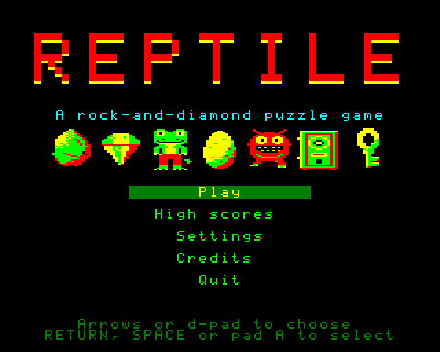
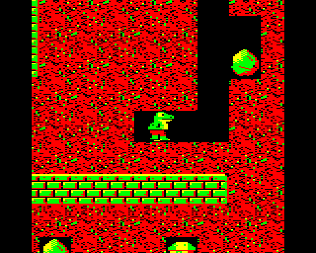
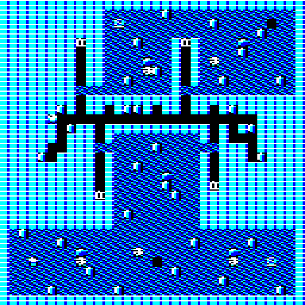

# Reptile

Reptile is a rock-and-diamond puzzle game for Windows, with a map designer for building and sharing your own levels.

You guide a lizard through mazes of earth and stone, digging out every diamond while rocks fall and roll around you, eggs hatch into monsters, spirits drift along the walls and fungus creeps into every open space. Most screens are puzzles: the order you dig in decides whether a diamond can still be reached. Reptile ships with four themed packs, **Caverns**, **Glacier**, **Sunken Temple** and **Foundry**, forty-two screens in all, each blind play-tested and each with a recorded solution proving it can be done.

Reptile is inspired by the rock-and-diamond games of the 1980s home-computer era, and above all by the BBC Micro classics of 1985, whose rules it follows as closely as they can be established: the lizard moves a quarter of a cell per tick while rocks fall a whole cell, rocks roll left first off rounded objects, the "shuffle" works, and the play window is the original eight-by-eight cells with the player dead centre. It is an independent, original work: its name, lizard, sprites, music, sound effects and every level were made for this project, and no material from those games is used or reproduced.

## Download

Get the latest build from the [Releases](../../releases/latest) page. Two downloads are offered:

| File | What it is |
|---|---|
| `Reptile-<version>-setup.exe` | Installer. Installs for the current user by default with no administrator prompt, adds **Reptile** and **Reptile Map Designer** to the Start Menu, and can associate `.reptilepack` files with the designer. Uninstalls cleanly and keeps your progress. |
| `Reptile-<version>-win-x64.zip` | Portable build. Unzip anywhere and run `Reptile.exe` or `Reptile.Editor.exe`. Nothing else needs to be installed. |

Windows 10 or 11, 64-bit. Both builds are self-contained and do not need the .NET runtime installed.

The downloads are not code-signed, so Windows SmartScreen may ask you to confirm the first time you run them.

## Playing

Choose **Play**, pick a pack, pick a screen. Arrow keys or WASD move (Z X : / and a gamepad also work). RETURN or ESCAPE pauses and shows the status screen with your score, time, lives and the diamonds left; press M there for the map on screens that allow it. Collect every diamond to finish a screen. Each completed screen gives you a password that lets you return to it later, on any machine.

The full rules, controls and settings are in the [player manual](docs/MANUAL.md).

Your progress, settings and high scores are saved per Windows user in `%APPDATA%\Reptile`. A fresh install for another user starts with nothing completed.

## The packs

| Pack | Theme | What it introduces |
|---|---|---|
| Caverns | Classic underground | Rocks, diamonds, eggs and monsters, keys and safes. Twelve screens. |
| Glacier | Ice caves | Skulls, wandering spirits and the cages that trap them, one-shot transporters. |
| Sunken Temple | Drowned ruins | Time capsules that reset the clock, the crown, and the time bomb you must defuse last. |
| Foundry | Industrial | Creeping fungus, and everything the earlier packs taught, combined. |

Each pack ramps from two gentle warm-up screens through a mid block with breathers to three hard screens and a showpiece. Every screen was played blind by a tester who had not seen its design, and retuned until every death traced to a visible decision.

## Making your own levels

**Reptile Map Designer** is included. Paint a level with the pencil, fill and rectangle tools, set its palette, timer and completion rule, and press F5 to test-play it in the game. The problems panel flags unreachable diamonds, rocks over the start and other mistakes as you draw. When a level is right, record your solution so the designer can re-check it after every edit.

Levels are grouped into packs. The pack manager orders levels, validates the whole pack and exports it as a single `.reptilepack` file you can share. Anyone with Reptile can install a `.reptilepack` into `Documents\Reptile\Packs`, where the game's pack browser picks it up.

The [editor guide](docs/EDITOR-GUIDE.md) covers all of it, and the designer has a built-in help panel.

## Licence

Reptile's code, art, sound, music and levels are original works. The project's own licence has not yet been chosen; until it is, all rights are reserved. You are welcome to download and play the game and to make and share your own level packs with it.

Reptile is built on third-party components, each under its own licence: the .NET runtime, MonoGame, SDL2, OpenAL Soft, NVorbis and the .NET Community Toolkit. Their notices are in [THIRD-PARTY-LICENSES.txt](THIRD-PARTY-LICENSES.txt) and in `LICENSES.txt` inside every release. OpenAL Soft is licensed under the LGPL and ships as a separate, replaceable `openal.dll`.
